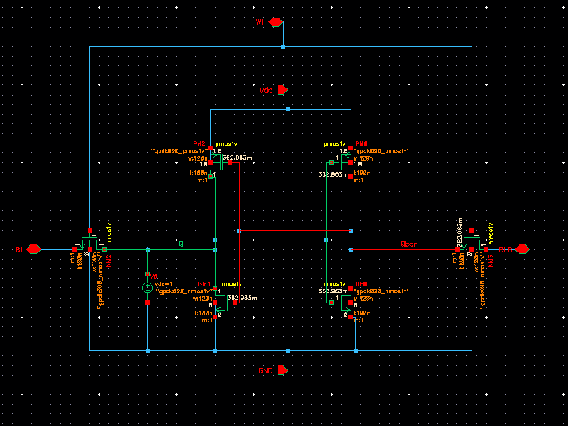

# 6T SRAM Cell Design and Analysis

## Overview
This project presents the design and analysis of a CMOS 6T SRAM cell using Cadence Virtuoso. The work includes schematic design, layout implementation, and simulation analysis of SRAM storage behavior.

## Tools Used
- Cadence Virtuoso
- CMOS Technology Library
- Analog Simulation Environment

## Project Features
- 6-Transistor SRAM cell schematic design
- Physical layout implementation
- DC transfer characteristic analysis
- Read operation simulation
- Logic '0' and Logic '1' storage verification
- SRAM butterfly curve analysis

## Results

### Schematic View

Schematic design of the CMOS 6T SRAM cell.

---

### Layout View

Cadence Virtuoso layout implementation of the 6T SRAM cell.

---

### Read Operation (Logic 1)

Simulation waveform showing stored logic '1' read operation.

---

### Read Operation (Logic 0)

Simulation waveform showing stored logic '0' read operation.

---

### DC Butterfly Curve

Static Noise Margin analysis using the SRAM butterfly curve.

## Conclusion
The CMOS 6T SRAM cell was successfully designed, simulated, and analyzed using Cadence Virtuoso. The results demonstrate proper memory storage behavior and validate the functionality of the SRAM cell.

## Author
**Afnan Alvi**
